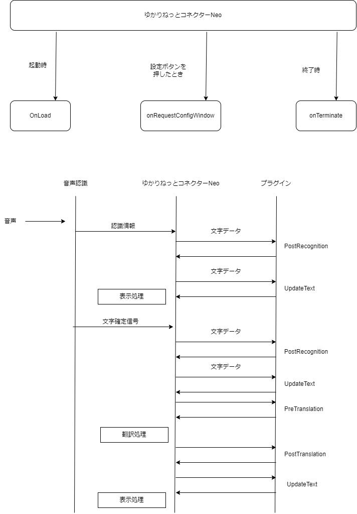

# YNCNeo_Plugin
ゆかりねっとコネクターNEOプラグイン開発キット

## これは何をするものですか？
* 多言語字幕翻訳ツール「[ゆかりねっとコネクターNEO](https://www.machanbazaar.com/ync-neo/)」のプラグイン開発キットです。
* 音声に応じ、配信プラットフォーム、xRツール、ハードウェアと連動させることを狙いとしています。

> [!IMPORTANT]
> **ゆかりねっとコネクターNEO v3.0 で本体が .NET Framework 4.8 から .NET 10 に移行しました。**
> この雛形（2026/10 版）は v3.0 以降向けです。旧雛形（.NET Framework 4.8）で作ったプラグインは
> v3.0 では正しく動かないことがあるので、[旧雛形からの移行](#旧雛形net-framework-48からの移行)を参考に作り直してください。
> 逆に、この雛形で作ったプラグインは v2.x 以前の本体では読み込めません。

## 作成に必要な環境
* Windows 10 / 11 (x64)
* [.NET 10 SDK](https://dotnet.microsoft.com/download/dotnet/10.0)
* Visual Studio 2026 以降（「.NET デスクトップ開発」ワークロード）、または .NET 10 SDK とお好みのエディタ
* C#

## 最低限必要なライブラリ
* Newtonsoft.Json 13.0.4（NuGet の復元で導入されます）

本体の SDK（`YNC_PluginSdk`）は**必須ではありません**。この雛形は SDK を使わず、本体との契約をリフレクションだけで満たしています。
SDK を使いたい場合は [SDK を使う場合](#sdk-を使う場合任意) を参照してください。

## フォルダ構成

| パス | 内容 |
|---|---|
| `Plugin_Prototype.sln` / `.csproj` | プラグイン雛形（SDK 非依存）。通常はこれをコピーして作ります |
| `UserProgram.cs` | **ここに処理を書きます**（プラグイン名・フック・設定画面の処理） |
| `PluginFunction.cs` | 本体との連携部分（コールバックの受け取り・設定の保存・補助関数）。通常は編集不要 |
| `ConfigWindow.*` | 設定画面（WinForms） |
| `plugin_prop.json` | 「プラグインを追加」画面に出る説明（ジャンル・表示名・説明） |
| `docs/API_REFERENCE.md` | **フック・本体 API・設定キーの詳細な仕様** |
| `SDK/lib/` | 本体に同梱されている SDK の参照用 DLL とドキュメント（任意） |
| `Samples/Plugin_SdkSample/` | SDK を使った最小プラグインの例（任意） |

## プラグインの作り方
1. `Plugin_Prototype.sln` を Visual Studio で開いてください（または `dotnet build` でビルドできます）。

2. NuGet パッケージの復元でライブラリ構成を復元します（ビルド時に自動で行われます）。

3. プラグインの名前をきめてください（`UserProgram.cs`）。
	* `Plugin_ID` に GUID 形式でぶつからない ID をきめます。ぶつかった場合はプラグインが正常に読み込まれません。
	  （Visual Studio の「ツール → GUID の作成」や PowerShell の `[guid]::NewGuid()` で作れます）
	* `Plugin_Name` に名前をいれます。言語ごとに出し分けられます。
	* `Plugin_Tag` に識別タグをいれます。設定保存にこの名前が使われます。プラグインを自作する場合は「Plugin_作者識別ニックネーム_ツール識別名」をベースに命名してください。
	* `Plugin_Prototype.csproj` の `<AssemblyName>` を `Plugin_Tag` と同じ名前にします（DLL 名と一致しているとロードが速くなります）。
	* `plugin_prop.json` の `tag` / `id` / 表示名・説明を書き換えます。
	* ※ `Plugin_ID` と `Plugin_Tag` は **public フィールド**、`Plugin_Name` は **public プロパティ**のままにしてください（本体がリフレクションでその形で読みます）。

4. 処理を書き込みます（`UserProgram.cs`）。処理フローは下記の通りです。

   

   * 図のほかに、v3.0 では次のフックがあります。詳しくは [docs/API_REFERENCE.md](docs/API_REFERENCE.md) を参照してください。
     * `onEnabled` / `onDisabled` … プラグインの「使う」をオン / オフにしたとき
     * `onCommand` … HTTP の `/api/command` や他のプラグインからコマンドを受けたとき（戻り値を返せます）
     * `CaptionAfterView` … 字幕の表示が終わったあと
   * `onTrigger` は本体から呼ばれなくなりました。
   * **使わないフックはメソッドごと削除してください。** 本体は「メソッドがあるかどうか」で呼ぶかを決めるため、空のフックでも発話のたびに呼び出しのコストがかかります。
   * **フックの中で待たないでください。** フックは 8 秒でタイムアウトし、3 回続くと 120 秒間呼ばれなくなります。通信などの時間のかかる処理は `RunBackground(() => { ... })` で裏へ逃がしてください。

5. コンパイルしてください。`bin\Release\`（または `bin\Debug\`）に次のファイルが出力されます。
	* `Plugin_Prototype.dll`（プラグイン本体）
	* `Plugin_Prototype.deps.json` / `Plugin_Prototype.runtimeconfig.json`
	* `Newtonsoft.Json.dll` などの依存ライブラリ
	* `plugin_prop.json`

6. ゆかりねっとコネクターNEO がインストールされているフォルダに `Plugin` フォルダがあるので、その中に自分のプラグイン用のフォルダを作り、手順 5 で出力されたファイルを**すべて**入れてください。
	* 配布するときは、この段階で Windows のセキュリティによりブロックされることがあるため、インストーラを用意することを推奨します。

7. ゆかりねっとコネクターNEO を起動します。正しく認知されていれば、プラグインリストに名前が表示されます。
	* 表示されないときや、設定ボタンが効かないときは `%APPDATA%\YukarinetteConnector\Log` の `*_app.log` を確認してください（プラグイン内の例外はログに書かれるだけで、画面には出ません）。

## 守ってほしいこと（v3.0 の実装上の注意）

| してはいけないこと | 何が起きるか | 代わりに |
|---|---|---|
| フックの中で `.Result` / `.Wait()` や同期版 API（`getTranslate` / `getLanguage` / `callGPTFunction` / `getSentiment`）で待つ | そのプラグインの専用スレッドが塞がり、8 秒でタイムアウト。同じプラグインのほかのフックも巻き添えでスキップされる | `RunBackground` の中で非同期版（`getTranslateAsync` など）を使う |
| `onLoad` / `onEnabled` / `onDisabled` で通信・停止処理を待つ | UI スレッドで実行されタイムアウトも無いため、**アプリ全体が固まる** | `RunBackground` で裏へ逃がしてすぐ返す。待つなら必ず上限を付ける |
| `async void` や、例外を握らない生の `Task.Run` | 例外でアプリごと落ちることがある | `RunBackground` を使う（例外はログへ） |
| 呼び出しのたびに `new HttpClient()` | ソケットの枯渇 | `HttpClient` は static で 1 つ持って使い回す |
| フックから設定画面などの UI を直接触る | クロススレッド例外 | `RunOnUIThread(() => { ... })` で UI スレッドへ渡す |
| `onTerminate` で `cw.Dispose()` を直接呼ぶ | .NET 10 の WinForms は作成元以外のスレッドからの破棄を例外で弾く | 雛形の `DisposeWindowSafely(cw)` を使う |
| `SaveConfig()` の中で画面の値を読む | UI スレッド以外から呼ばれることがある | OK を押したときに `ConfigData` へ移しておく |
| 設定画面のボタン変数名を `AcceptButton` / `CancelButton` にする | Form の同名プロパティを隠し、Enter / ESC が効かなくなる | `btnOK` / `btnCancel` など別の名前にする |
| 補助の public メソッドに `PostRecognition` / `onCommand` などフックと同じ名前を付ける | 本体がフックとして呼んでしまう | 補助メソッドは `private` にする |
| 本体より新しい版の `Newtonsoft.Json` の API を使う | 本体が先に読み込んだ版が使われるため、実行時に落ちる | 13.0.4 の範囲で使う |

## 旧雛形（.NET Framework 4.8）からの移行

1. csproj を SDK 形式・`net10.0-windows` にする。`<EnableDynamicLoading>true</EnableDynamicLoading>` を必ず付ける（付けないと依存 DLL が出力されず、読み込み時に落ちる）。この雛形の `Plugin_Prototype.csproj` をそのまま使うのが簡単です。
2. `packages.config` を削除し、`PackageReference`（Newtonsoft.Json 13.0.4）に置き換える。
3. コールバックを `dynamic` で受けていたら、本体と同じ `Action` / `Func` の型で受け取る（`PluginFunction.cs` をこの雛形のものに差し替える）。型が 1 つでもずれると `null` になります。
4. `setSettingParam` は**引数が 3 つ**（`name, value, sender`）になりました。`sender` には `Plugin_Tag` を渡します。
5. 読み上げ API で有効にするキーは `Common.sendSpeech.PluginEnabled` です（旧雛形の `Common.sendSpeechV2.PluginEnabled` は使われません）。雛形の `enabledFunctionOnSpeech()` を使えば対応済みです。
6. `onCommand` の戻り値を `void` から `string` にする。
7. `onTrigger` は呼ばれなくなったので削除してよい。
8. `onTerminate` の `cw.Dispose()` を `DisposeWindowSafely(cw)` にする。
9. 設定画面のボタン変数名・モードレスの開き方を見直す（上の表）。
10. フックに渡される `Message` のキーは欠けていることがあるので、`(bool)Message["xxx"]` のような直接キャストをやめ、雛形の `GetValue(Message, "xxx", 既定値)` で読む。
11. `plugin_prop.json` を置く。

## SDK を使う場合（任意）

本体には共通 SDK `YNC_PluginSdk.dll` が同梱されています（v3.0 以降）。SDK を使うと、コールバックの受け取りや設定の保存などの定型コードを省略できます。

* `PluginBase` … 基底クラス。`Plugin_ID` / `Plugin_Tag` / `Plugin_Name` / `Plugin_ApiVersion` と `onLoad` を持ち、`Host` プロパティから本体の API を型安全に使えます。
* `PluginHost` … 本体から渡されるコールバックの一覧（`Host.WriteLog`、`Host.SendTextdataV2` など）。
* `ConfigStore<T>` … `{ConfigFolder}\{Plugin_Tag}.config` への設定の保存・読み込み。
* `SafeTask.Run` … 例外でアプリを巻き込まないバックグラウンド実行。
* `SharedHttp.Client` … プロセスで共有する `HttpClient`。

参照用の DLL は `SDK/lib/YNC_PluginSdk.dll` です。使い方は `Samples/Plugin_SdkSample/`（`Samples/Plugin_SdkSample.sln`）と [SDK/README.md](SDK/README.md) を参照してください。

> [!WARNING]
> **`YNC_PluginSdk.dll` をプラグインのフォルダに入れて配布しないでください。**
> 本体の exe と同じフォルダに 1 本だけ置かれているものが使われます。プラグインのプロジェクトからは
> `<Reference>` に `<Private>false</Private>` を付けて参照し、出力にコピーしないようにしてください（サンプルの csproj がこの設定になっています）。
> 同じ名前の DLL はプロセスで 1 つしか使われないため、版違いが混ざると挙動が壊れます。

* SDK を使ったプラグインには `Plugin_ApiVersion`（現在 `1`）が付き、本体が対応していない新しい版を要求するプラグインは読み込まれません。
* SDK の `PluginBase` は `PostRecognition` などのフックを宣言していません。使うフックは `override` ではなく、同じ名前の public メソッドとしてそのまま書いてください。

# 免責事項
* ゆかりねっとコネクターNEO は開発が続いており、予告なく仕様が変わる可能性があります。
* プラグイン雛形（2026/10/20 公開版）は、ゆかりねっとコネクターNEO v3.0 以上（.NET 10 版）に対応しています。それより前の本体では読み込めません。
* 古い本体には存在しないコールバックがあります。コールバックは呼び出す前に必ず `null` チェックをしてください。
* 説明していないパラメータが関数内に渡される事がありますが、将来もアクセスできるかどうかについて保証はありません。
* 戻り値に不正な値を渡さないように注意してください。場合によっては他のプラグインやゆかりねっとコネクターNEO が不正な動作をしたり、異常終了する原因となります。
* 内部構成の作りがあまりイケてない部分はありますが、数年前からの過去のアーキテクチャを引きずった結果です。ゆかりねっとコネクターNEO 自体の構造変更のタイミングで見直す時期が来るとおもいます。

# 禁止事項
* 本プラグインが扱うデータを使って機械学習やデータ転用をすることを原則禁止します。とくに、音声認識や翻訳に関しては、各プラットフォーマ利用契約上の問題があるため禁止です。
* これらのプラグイン機能によってプライバシーに関する配慮が必要な情報に触れる可能性があります。ユーザの意思によらない形で情報の収集や転用をすることを禁止します。
* 各プラットフォームやゆかりねっとコネクターNEO の運用に損害や支障をあたえるようなプラグインを製作しないでください。

# そのほか
* 本体から使えるインタフェイス（コールバック）、各フックに渡される値、`getSettingParam` / `setSettingParam` で使える名前、状態表示の方法などは [docs/API_REFERENCE.md](docs/API_REFERENCE.md) にまとめています。
